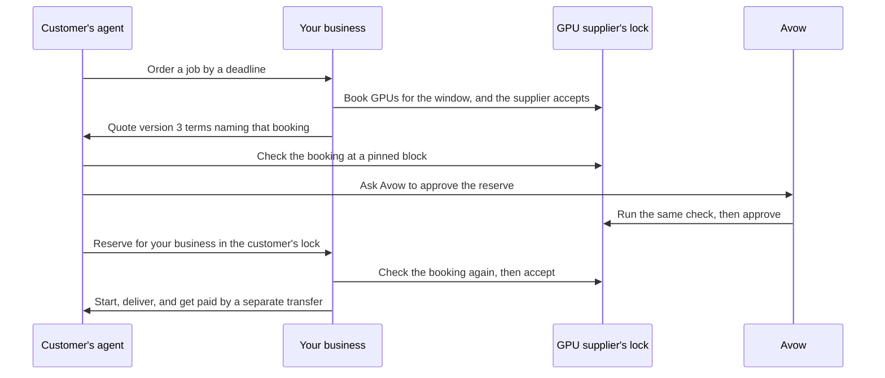

A job is a piece of work your business does for a customer by a deadline, on GPU capacity your business booked from someone else. The `job/1` template in `@avow-finance/spec` describes one, and its terms are always [version 3](/docs/composable-commitments/terms-v3), since a job names the compute booking it runs on. The customer checks that booking before it commits, and your code checks the customer's commitment before work starts.

## How a job runs

Each check reads the chain itself and names the block it read. No money moves between the two locks, and each commitment settles on its own.

## The template

| Field | What it holds |
| --- | --- |
| `work.kind` | A short kind of work, such as `fine-tuning` |
| `work.summary` | One sentence on the work |
| `compute` | The GPU, how many and the region |
| `startsAt` | When work starts, which is also when free cancellation ends |
| `deliverBy` | The deadline for delivery |

`jobTerms` builds the terms, and `testnetDemoJobTerms` gives the job Avow's test customer offers on testnet.

Every job falls under the mandate category `compute-job`, which `JOB_CATEGORY` names, so a customer's mandate allows jobs by naming it. Job terms under any other category are refused as `terms.category_mismatch`.

The template's rules are fixed.

- Free cancellation ends exactly when work starts, and your business accepts the customer's reserve by then.
- A late cancellation is chargeable from the start, and a no-show once the grace period after the start has passed without the customer handing over the work's inputs.
- The deadline falls by the charge deadline.
- The consideration is one fixed price above zero.

A job's terms always say the buyer checks the bookings they rely on. The `avow` setting promises to hide the booking from the buyer, which a job can't keep, since the customer gets the terms in full and a link to verify a job shows the booking. So job terms in the `avow` setting never get through. The parsers refuse them first, as `terms.invalid` for terms read on their own and as `message.invalid` inside a request's body, and a check handed them as values refuses them as `terms.template_invalid`.

Job terms in version 2's shape name no compute. They read, so a check can say why it refuses them, and every check refuses them as `dependency.required`. The customer and Avow's API run the same check, so they refuse with the same code.

A job fits inside a GPU reservation that holds the same GPU in the same region, at least as many of them, from the job's start until its deadline. The dependency check refuses anything else as `dependency.does_not_fit`, and a booking still inside its free cancellation as `dependency.cancellable`.

## Job offers

A supplier can publish a standing offer of one kind of job, so a buyer's agent can order it without asking first. A `JobOfferVersion` in `@avow-finance/spec` holds it, and a version never changes. A new price, other compute or a change to the rules is a new version with a new id.

| Field | What it holds |
| --- | --- |
| `template` | Always `job/1`, so the version reads as a job's wherever it's carried |
| `supplier` | The supplier's business id |
| `work` | The kind of work and one sentence on it, as the job's terms name them. The kind is plain text on one line with no quotes, since it's the item a seller's mandate reads and a person reads it on a card |
| `compute` | The GPU, how many and the region every job of this version runs on |
| `currency`, `price` | One fixed price for the whole job, in micros, paid by a separate transfer on delivery |
| `rules.startAfter` | How long after the order work starts, at least 15 minutes, which is `JOB_OFFER_START_MIN` |
| `rules.turnaround` | How long from the start the job is delivered by |
| `rules.gracePeriod` | How long after the start the buyer can hand over the inputs, up to the turnaround |
| `rules.dailyCapacity` | How many of these jobs the supplier takes in a day, which whoever accepts for the supplier counts |
| `rules.lateCancellationBps`, `rules.noShowBps` | Each charge as a share of the price, with at least one above zero |

Every length counts from the order, so a version names no clock time and can stay listed. `jobOfferVersionId` hashes the version's canonical JSON under the label `avow:offer:job/1`, so a job offer's id never equals a service offer's. `vectors/job-offer-v1.json` holds vectors another implementation can check its canonical JSON and ids against.

The buyer builds the job's terms with `jobOfferTerms`, in version 2's shape, and orders them as it orders any job. Work starts `startAfter` after the order, which ends free cancellation and is when the supplier accepts by, and delivery is due `turnaround` later. Each charge is its share of the price rounded up to the micro, which `jobOfferQuote` gives, so a charge is never less than the share the offer states. Charges can be reported until 24 hours after the deadline, when the reserve comes back. The supplier books the compute and quotes the same terms with the booking added, as version 3 terms, exactly as for a job ordered without an offer.

Job terms name no offer, since `job/1` has no field for one, and a job ordered without an offer runs as it always has. `jobTermsMatchOffer` says whether terms, in either shape, are exactly the ones a version builds, for whoever holds that version. It never reads the version from the terms, so the supplier's agent checks an order against a version it published itself.

`OfferVersion` is either kind of offer. `parseOfferVersion` reads one from JSON, `offerIdOf` gives its id under its own label, and `offerItemOf` names its item under its category, so a service and a job that share a name stay apart. A seller's agent checks a job offer against its seller's mandate with `sellerOfferProblem` before it publishes, as the [seller's mandate](/docs/reference/seller-mandate#listing-an-offer) page says. A person can't approve a job's sale yet, so a job offer priced where the mandate asks a person to decide doesn't list.

`sandboxServices().publish` in `@avow-finance/sdk` keeps a job offer in the agent's folder, and `listWithAvow` lists it in Avow's directory, as [Listing offers with Avow](/docs/reference/offer-listings) describes. A buyer's agent orders one through the sandbox mailbox with `sandboxMailbox().order({ supplier, offer })` or `buy`, which build the job with `jobOfferTerms` and let the order lapse a minute before work starts at the latest. When the supplier's agent sells an order for a kind of work it published an offer of, it checks the terms with `jobTermsMatchOffer` against its current version before it books any compute, and quotes nothing for terms that don't match, such as an order built from a version it has since replaced, or built from a moment more than a minute ahead of its own clock. It also counts the jobs of that kind it holds against the offer's `dailyCapacity`, each accepted one for a day and each quoted one until its acceptance deadline. It takes the order's place before it books any compute and gives it back if the booking fails, so an order past the capacity books nothing and lapses, and two orders at once can't both book compute for the last place. An order for a kind of work it has published no offer of, including one whose offer it withdrew, is sold as any job is.

## What the customer's reserve backs

The lock knows two charge kinds, late cancellation and no-show, and the customer's reserve backs only those. It backs what the job's terms let your business charge if the customer walks away, a late cancellation after work has started or a no-show, each up to the cap the terms name. Your business reports a charge, Avow confirms it only when its own records support it or refers it to a ruling, and the customer can contest it before the contest window closes.

The job's price arrives as a separate transfer on delivery, with the job's commitment id as its memo. Avow records that transfer as evidence, and the reserve doesn't secure it. Nothing backs your own delivery promise with money in this version.

## What each check proves

Each check proves the state at the block it read, and names that block. The customer's check reads your compute booking at a recent finalized block, and your acceptance check reads it again. Nothing makes the steps atomic, and nothing stops your business cancelling its compute after the customer accepted. If it does, the job commitment stands, and your business still answers to the customer under the job's own terms.

## The test customer

Avow's test customer is a sandbox business on testnet, labelled as Avow's test customer in everything it returns. Its own agent key funds its reserves from its own account. Orders arrive by pull, so your machine needs no inbound connection. Its origin is the sandbox deployment's `customerUrl`, and `TEST_CUSTOMER_PATHS` names its routes.

| Route | What it does |
| --- | --- |
| `GET /v1/profile` | The customer's label, business id, account, lock, chain, mandate hash and limits |
| `POST /v1/orders` | Takes your supplier profile and answers with an offer, which names the commitment id, the proposed job terms, the compute the quote has to rely on and the offer's expiry |
| `POST /v1/orders/{orderId}/quote` | Takes the version 3 terms, their salt, the terms agreement your signing key signed, its signature and the subject section of each booking relied on, and answers 202 while the customer verifies. The customer's agent [commits to the quote](/docs/composable-commitments/commit-to-quote) once it passes |
| `GET /v1/orders/{orderId}` | Where the order stands, from `offered` through `verifying`, `refused`, `reserved`, `accepted` and `delivered` to `paid`, with each check's block, the reason and who refused, the reserve with the transaction that funded it, the payment, and what the customer has said and stated so far |
| `POST /v1/orders/{orderId}/delivery` | Takes a `DeliveryReport`, the result handed over with its label and hash, and answers 202, and the customer then pays |

Every POST is a signed API request, signed by your supplier signing key, with the customer's origin as its audience and the customer's lock as its domain. The GETs are unsigned. An order belongs to the supplier it was offered to, since an order's id appears in every job event and anyone with the screen's link can read it. A refusal has the API's error shape and one of these reason codes.

| Reason code | When |
| --- | --- |
| `order.supplier_mismatch` | A key other than the offered supplier's signing key quotes or reports delivery |
| `order.unknown` | The order doesn't exist |
| `order.out_of_step` | The request is for a step the order isn't at |
| `message.expired` | The offer expired |
| `order.limit_reached` | Too many orders are open |
| `order.terms_changed` | The quote's terms change anything beyond the compute they add, which `quoteTermsProblem` checks |
| `order.commitment_mismatch` | The agreement's commitment id isn't the offer's |

An order's state carries what the customer says as `said`, messages numbered from 0, and what its verifier stated as `facts`, each numbered from 0 with the check it came from, `verifiedBy: 'customer'`, the commitment it's about, the block it read and any transaction. Your session posts each one once, by its index, as the customer's speech or the customer's statement. A fact the customer states is the customer's word until a reader checks it from the chain.

The work is simulated, so the delivery hands over a placeholder whose label says so plainly, with the hash of its content. The GPUs and the training are simulated, and every commitment, reserve, check and payment is a real testnet operation.

## Compute offers

A GPU supplier that lists compute for jobs answers an unsigned `GET /offers?startsAt=…&deliverBy=…` under its adapter with its `ComputeOffers`, as `computeOffersPath` builds the path. Each `ComputeOffer` names its GPU, region and SKU, how many GPUs one booking takes, its window, its free-cancellation deadline, its usage price per GPU-hour, which is paid separately and never secured by the reserve, and its reserve per GPU. An offer whose free cancellation had ended when it was listed is firm. `computeOfferTerms` builds the GPU reservation terms for booking a number of GPUs of an offer, and `computeOfferCost` gives the usage price and the reserve, so an agent books exactly what the offer says. The supplier still decides what it signs. `demoComputeOffers` gives the four offers Avow's demo GPU supplier lists for a job, where one is clearly best and each other fails a check that names why. On testnet the test customer keeps an offer open for a minute and work starts a minute after it lapses, as `DEMO_JOB_TIMING` says, and the demo supplier's offers lapse with the customer's, so your agent books compute by the time it has to quote.

## Session events

A job's process posts its events to the same session as the rest of the sandbox, and the screen shows them as they arrive. A kept job posts these, in order.

1. `job_order_received`
2. `job_compute_secured`
3. `job_quote_sent`
4. `job_customer_verifying`
5. `job_customer_verified`, or `job_customer_refused`
6. `job_commitment_checked`, or `job_commitment_refused`
7. `job_work_started`
8. `job_delivered`
9. `job_paid`
10. `job_reserve_released`

A job the customer cancels after its start posts `job_customer_cancelled` in place of the delivery and the payment, then each step of the charge: `job_charge_reported`, `job_charge_confirmed`, and `job_charge_paid` or `job_charge_paused`. A refusal carries its reason code, who refused and the block its check read. `jobEventSentence` gives the one sentence the terminal and the screen both say for each, and the decisive sentence for `job_commitment_checked` is `DECISIVE_SENTENCE`.

Your agent session posts its own events to the same session, beside the job's. Each names its run, and the order when it belongs to a job, since each job is its own run and a turn you start is its own run with no order. `said` is speech, from a model by its id, `scripted` for the deterministic fixture, or the customer. `tool_call` and `tool_result` pair a call with what it returned, in a summary code wrote, a refusal with its reason code and layer, and a listing of offers with the offers and the limits that applied. `fact` and `commitment` carry who verified them, `service` for your `service.ts`, `customer` for the customer's verifier or `avow` for Avow's API, with the commitment on the chain, the block and any transaction, and a job's receipt carries what a link to verify it carries. A refusal's layer is `service` for your `service.ts`, `sdk`, `avow`, `customer` for the customer's verifier, `supplier` for the supplier you book with, `relay`, `lock`, `keychain`, or `unknown` for a transaction whose fate nobody gave, one that expired in no block, that the node never took, or that went out while the node wouldn't give its latest block. A result shown again as evidence names the run and call that made it, and a reader shows that original event and refuses a copy that differs.

A signed event is an attributed statement. Its signature says who posted it, never that what it says is true, so a reader checks from the chain what it can before showing anything as verified. Your own messages to your agent stay in your terminal and are never posted as events, but your agent's replies can repeat them, since `said` carries its words.

## A link to verify a job

A `#verify=` token from `encodeCommitmentReference` names only the job's terms hash. `encodeJobVerification` adds the terms' header, the dependencies section in clear with that section's own salt, and the hash of every other section. A browser recomputes the terms hash with `jobVerificationProblem`, matches it against the lock's, and reads the compute booking the dependencies section names at a block it pins. The one section salt reveals no other section, so the link doesn't show the job's subject, with its work, compute and deadline, or its price. Once the job is paid, the payment transfer shows the price, since its memo is the job's commitment id. The lock already shows anyone what it enforces for the job, which is the reserve, each charge's cap and the moment it becomes chargeable, the deadlines, the contest window and the release date. Free cancellation ends when work starts, so the lock shows the start too. The JSON's `kind` tells a job's token from a commitment reference's.

`verifyJobVerification`, in `@avow-finance/verifier`, is the check a page runs on such a link. It pins one recent finalized block, reads the job commitment from the customer's lock, and takes the supplier from the lock's record of it, which the lock copied from Avow's approval. It then runs the dependency check's tests that need only the chain on each compute booking the job names, which are provenance, ownership by that supplier, state with free cancellation, the terms hash the lock holds and a fresh block. Fit and the shown section need the job's terms in full, so it skips both. Each booking comes back marked with fit unchecked, a type of its own, so it can't pass for the `CheckedDependency` a full check gives.

The result is an outcome a page has to switch on, with the job's state as the lock held it at that block, and only one outcome is a job that stands.

| Outcome | The job | Its bookings |
| --- | --- | --- |
| `refused` | The link doesn't match the chain or couldn't be read, or a booking a reserved job relies on doesn't stand | The one that failed, by its place, with the reason and the block |
| `awaiting_acceptance` | Reserved, and your business hasn't accepted | Every one stands, since they gate the acceptance |
| `stands` | Accepted, with no report filed | Each as read, standing or with its reason at its block |
| `charge_pending` | A charge reported and pending, or paused while the customer contests it, with the reserve still held | Each as read |
| `ended` | Its reserve released, charged or resolved | Each as read |

An accepted job with a report filed counts as a charge pending, by the same rule the dependency check applies to a booking relied on. Once the customer has accepted, a compute booking cancelled or failed after that leaves the job standing, so the job keeps its outcome and the booking shows why it doesn't stand at that block. A read on the job's own chain that finds the pinned block's hash changed refuses the whole link as `reference.unreadable`, since the job was read at that same block.
