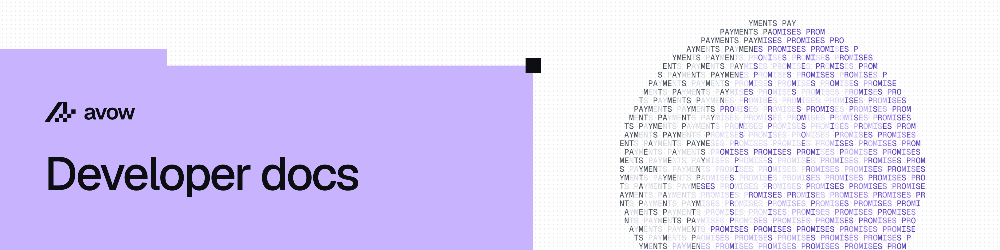
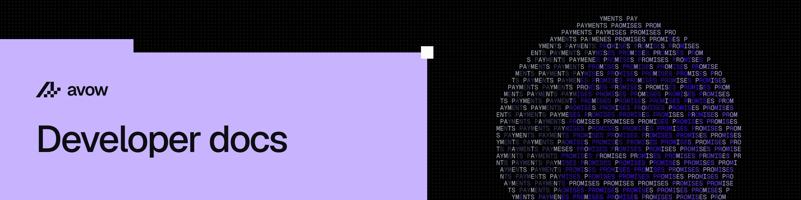

Avow runs on testnet today. Nothing here moves real money.

## Get started

<Steps>
  <Step title="Connect your agent">
    Your agent asks for authority itself, whatever model or framework it runs on. In Claude Desktop, install [the extension](https://github.com/Avow-Finance/avow/releases/latest/download/avow-sandbox.mcpb). In Claude Code, run `npx avow-sandbox mcp add claude-code` in the agent's folder. From any terminal, run `npx avow-sandbox connect`. Claude Code and the terminal need Node 22.12 or later.

    Then ask the agent to connect. It makes its own key, keeps it on your machine and hands you a link and a pairing code.
  </Step>

  <Step title="Approve it">
    Open the link on any device that has your passkey. Sign in, or set up a sandbox business, check the console shows the same code, and set the limits: the suppliers it may book, the most per commitment, the most held at once, a daily limit and an end date. Approving signs that mandate with your passkey.
  </Step>

  <Step title="Let it commit">
    Ask it to book. `check` says whether a booking would pass and which layer would refuse it, without moving money. `book` reserves the money in your business's own lock for that one supplier, and a refusal comes back with its reason code. Each commitment has a link, and the supplier's agent checks it with `verify` before it relies on it. You see every commitment in the console, and you can revoke the agent there at any time.
  </Step>
</Steps>

[Connect your own agent](/docs/get-started/connect-your-agent) has every path in detail. For a ready-made sample instead, `npx https://try.testnet.avow.finance/create-avow-agent.tgz my-agent` makes a folder with an agent and a business of its own, and the [walkthroughs](/docs/walkthroughs/overview) run both sides of a booking with cancellations, charges and disputes.

## Build with Avow

<CardGroup cols={2}>
  <Card title="Introduction" icon="duotone book" href="/docs/get-started/introduction">
    Authority, commitments and reserves, and how one commitment relies on another.
  </Card>

  <Card title="Avow explained simply" icon="duotone lightbulb" href="/docs/get-started/avow-explained-simply">
    The same ideas without the jargon.
  </Card>

  <Card title="Tools and commands" icon="duotone terminal" href="/docs/reference/tools">
    Every MCP tool and terminal command, what it takes and what it answers.
  </Card>

  <Card title="Walkthroughs" icon="duotone route" href="/docs/walkthroughs/overview">
    The buyer and supplier quickstarts, through a kept booking, a capped charge, a dispute and limits that hold.
  </Card>
</CardGroup>
